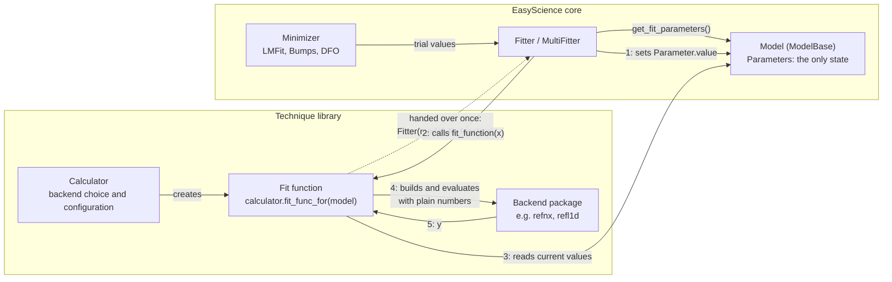

# Connecting an External Calculator

Technique libraries built on EasyScience usually compute their model
with an external package (for example refnx or refl1d for
reflectometry). This page describes how such a calculator connects to
the EasyScience model and to `Fitter`.

EasyScience does not provide a calculator base class, a factory or a
registry. A calculator is any object your library defines; the only
thing EasyScience sees is the fit function passed to `Fitter`.

## General overview



The arrows between the library and the model only point one way: the fit
function reads parameters, it never writes them. `Fitter` is the only
common point between core and the library, and the only thing passed
across is a callable.

## The Contract

- **EasyScience is the only store of parameter state.** Values,
  uncertainties, bounds, fixed flags and dependencies live in the
  `Parameter` objects of the model. The calculator does not keep its own
  copy.
- **The calculator reads the model when asked to calculate.** Each
  evaluation uses the current values of the independent parameters and
  of the dependent parameters derived from them.
- **Reading a parameter has no side effects.** `Parameter.value` returns
  the stored value; it never calls into a calculator.
- **Evaluation does not change the model.** Calculating leaves values,
  uncertainties, bounds, fixed flags, dependencies and the undo history
  as they were. Only the fitting engine writes parameter values during a
  fit, through the ordinary `value` setter.
- **Structural edits are seen by the next evaluation.** Adding or
  removing a part of the model needs no extra step, because the
  calculator reads the model fresh.

## A Minimal Example

The calculator below evaluates a straight line. It holds no parameter
values; it reads them from the model on every call.

```python
import numpy as np

from easyscience import Parameter
from easyscience.base_classes import ModelBase
from easyscience.fitting import Fitter


class Line(ModelBase):
    def __init__(self, slope: float, intercept: float):
        super().__init__()
        self._slope = Parameter(slope, display_name='slope')
        self._intercept = Parameter(intercept, display_name='intercept')

    @property
    def slope(self) -> Parameter:
        return self._slope

    @property
    def intercept(self) -> Parameter:
        return self._intercept


class LineCalculator:
    """Owned by the technique library, unknown to EasyScience."""

    def calculate(self, model: Line, x: np.ndarray) -> np.ndarray:
        # Hand plain numbers to the backend
        return model.slope.value * x + model.intercept.value

    def fit_func_for(self, model: Line):
        return lambda x: self.calculate(model, x)


model = Line(slope=1.0, intercept=0.0)
calculator = LineCalculator()

x = np.linspace(0, 10, 50)
y = 3.0 * x + 1.5 + np.random.default_rng(0).normal(0.0, 0.01, x.size)

fitter = Fitter(model, calculator.fit_func_for(model))
result = fitter.fit(x=x, y=y, weights=np.ones_like(x))

print(model.slope.value, model.intercept.value)  # close to 3.0 and 1.5
```

During the fit, the engine sets the parameter values and then calls the
fit function, so the calculator always uses the values being tried.

Dependent parameters need no special handling. If the intercept is made
dependent on the slope, the engine fits only the slope and the
calculator reads the recomputed intercept:

```python
model.intercept.make_dependent_on(
    dependency_expression='0.5 * s',
    dependency_map={'s': model.slope},
)
```

## Several Datasets

With `MultiFitter`, pass one fit function per dataset. A `Parameter`
object used by several models is fitted once and every calculator call
will read the same value:

```python
from easyscience.fitting.multi_fitter import MultiFitter

fitter = MultiFitter(
    [model_1, model_2],
    [calculator.fit_func_for(model_1), calculator.fit_func_for(model_2)],
)
results = fitter.fit(x=[x_1, x_2], y=[y_1, y_2], weights=[w_1, w_2])
```

## Performance

Rebuilding the backend object on every evaluation is simple and, for
typical models, cheap. If profiling shows that construction dominates,
build the backend object once when a fit starts, refresh only the
numbers on each call, and discard it when the fit ends. Such a
fit-scoped session lives inside the fit function in your library. The
parameter set does not change during a fit, so the session does not have
to track structural edits.

## Writing Values Back

EasyScience has no API for a backend to write values into the model, and
ordinary evaluation should never need one. If your library has an
operation that genuinely changes the model based on a backend result,
perform it in your own code through the public `Parameter.value` setter,
outside the fit, as an explicit step the user can see.

## Following a Fit Iteration by Iteration

Because the calculator only reads the model, it is not the place to
watch a fit's progress. To see the parameter values at each iteration,
pass a `progress_callback` to `fit()`. Starting again from a fresh,
independent line (the dependent intercept from the previous section
would not be in the payload, see below):

```python
model = Line(slope=1.0, intercept=0.0)
history = []


def on_iteration(payload: dict) -> None:
    # Called by the minimizer as the fit progresses. Values are keyed
    # by unique_name and describe the point the minimizer reports.
    values = payload['parameter_values']
    slope = values[model.slope.unique_name]
    intercept = values[model.intercept.unique_name]
    history.append((payload['iteration'], slope, intercept))
    print(
        f'iteration {payload["iteration"]:3d}: '
        f'slope={slope:.6f} intercept={intercept:.6f} chi2={payload["chi2"]:.4g}'
    )


fitter = Fitter(model, calculator.fit_func_for(model))
result = fitter.fit(x=x, y=y, weights=np.ones_like(x), progress_callback=on_iteration)
```

The callback receives a dictionary with these keys:

| Key                         | Meaning                                                                         |
| --------------------------- | ------------------------------------------------------------------------------- |
| `iteration`                 | Iteration or evaluation number, as counted by the minimizer                     |
| `chi2`                      | Chi-squared at the reported point                                               |
| `reduced_chi2`              | Chi-squared divided by the degrees of freedom                                   |
| `parameter_values`          | Values of the fitted parameters at the reported point, indexed by `unique_name` |
| `refresh_plots`, `finished` | Hints for user interfaces                                                       |

`parameter_values` holds exactly the parameters returned by
`model.get_fit_parameters()`: the free, independent ones. Fixed and
dependent parameters are not in it. To report a dependent value, read it
from the model or recompute it from the free values in the payload.

Its return value is ignored. To stop a fit from the callback, see
[Stopping a Fit](#stopping-a-fit).

When the callback is called, and which point it reports, depends on the
minimizer:

| Minimizer | Called                       | Reported point                              |
| --------- | ---------------------------- | ------------------------------------------- |
| LMFit     | on every function evaluation | the point just evaluated                    |
| Bumps     | once per optimizer step      | the optimizer's current point for that step |
| DFO       | on every function evaluation | the best point found so far                 |

With LMFit `iteration` is an evaluation counter, not a step index: it
starts at `-1`, the first few callbacks all describe the starting point,
the small steps of about 1e-5 are LMFit estimating the gradient
numerically, and the last number is reported twice. Compare the values
rather than the counter if you only want real steps. With DFO the
reported values change only when an evaluation improves on the best
point.

If you need a hook on every evaluation rather than every iteration, put
it in the fit function your calculator returns: it is called each time
and reads the current values from the model.

## Stopping a Fit

EasyScience has no single cancel switch that works the same way on every
minimizer. The options and how each minimizer responds:

| How                               | LMFit                     | Bumps                                            | DFO                                 |
| --------------------------------- | ------------------------- | ------------------------------------------------ | ----------------------------------- |
| Raise from `progress_callback`    | stops, raises `FitError`  | stops, raises `FitError`                         | stops, raises `FitError`            |
| Raise from the fit function       | stops, raises `FitError`  | stops only after logging every failed evaluation | stops, raises `FitError`            |
| `abort_test=` passed to `fit()`   | ignored with a warning    | stops, returns `success=False`                   | raises `FitError` (unknown keyword) |
| `fitter.max_evaluations` property | stops after N evaluations | stops after N optimizer steps                    | stops after N evaluations           |

### Raising from the progress callback

This is the one approach that works on all three minimizers. Each
minimizer catches the exception, puts the fitted parameters back to the
values they had before the fit, and raises `FitError` with your
exception as its argument. No undo entry is recorded.

A user interface can set a flag from its "Stop" button and let the
callback check it:

```python
from easyscience.fitting.minimizers import FitError


class FitCancelled(Exception):
    pass


stop_requested = False  # set to True from the user interface


def on_iteration(payload: dict) -> None:
    if stop_requested:
        raise FitCancelled()


try:
    result = fitter.fit(x=x, y=y, weights=np.ones_like(x), progress_callback=on_iteration)
except FitError:
    # The fit was cancelled; the model is back at its pre-fit values.
    ...
```

With LMFit and DFO the callback runs on every function evaluation, so
the fit stops at the next evaluation. With Bumps it runs once per
optimizer step, so the fit stops at the end of the current step.

### Raising from the fit function

Avoid using the fit function as a stop signal. LMFit and DFO stop as
they would for an exception from the callback, but Bumps catches the
error on every evaluation, logs a traceback, and carries on for many
failing evaluations before it gives up.

### `abort_test` with Bumps

Bumps, and the DREAM sampler, accept an `abort_test` argument: a
function without arguments that returns `True` when the fit should stop.
It is polled during the optimizer loop and once more after it finishes,
so it must have no side effects:

```python
fitter.switch_minimizer('Bumps')
result = fitter.fit(
    x=x, y=y, weights=np.ones_like(x), abort_test=lambda: stop_requested
)
if not result.success:
    print(result.message)  # 'Fit aborted before convergence'
```

Unlike raising an exception, an aborted Bumps fit returns normally and
keeps the best values found so far in the model. Do not pass
`abort_test` to the other minimizers: LMFit ignores it and runs the fit
to the end, and DFO rejects it with a `FitError`.

### Limiting the number of evaluations

Set the budget on the `Fitter` before calling `fit()`. Do not pass
`max_evaluations=` (or `tolerance=`) as a keyword to `fit()`: the
`Fitter` already forwards its own value, and a second one raises
`TypeError: got multiple values for keyword argument` on every
minimizer.

```python
fitter.max_evaluations = 100
result = fitter.fit(x=x, y=y, weights=np.ones_like(x))
if not result.success:
    print(result.message)
```

The budget means different things to the minimizers. For LMFit and DFO
it is a limit on function evaluations. For Bumps it is forwarded as the
optimizer's `steps` setting, and one step can contain several
evaluations, so the calculator may be called many more times than the
number you set. The `iterations` reported in the result and in the
progress payload count the same quantity as the budget for each
minimizer, so they are not comparable across minimizers. It is a budget,
not a cancel button, and it does not bound elapsed time when an
evaluation is slow.

## Migrating from `InterfaceFactoryTemplate`

EasyScience 3.0 removes the calculator factory and the parameter
callbacks that let a backend own parameter state. Libraries built on the
old mechanism need these changes:

- Replace imports of `easyscience.fitting.calculators`
  (`InterfaceFactoryTemplate`, `ItemContainer`) with calculator code
  owned by your library. Backend selection and switching live there too.
- Remove `Parameter(..., callback=...)`. It is no longer accepted and
  raises `TypeError`. Read the current value with `Parameter.value`
  inside your fit function instead; `value_no_call_back` is gone because
  `value` no longer calls a backend.
- Remove binding generation. The only thing EasyScience needs from your
  library is the callable handed to `Fitter(model, fit_function)`.
- `AnalysisBase` no longer takes an `interface` argument. Its
  constructor arguments are keyword-only, and `AnalysisBase.calculator`
  stores whatever object your library chooses.
- If your code replaced a calculator instance after creating a `Fitter`,
  hand the fitter a new fit function. A closure created earlier still
  captures the previous calculator.
